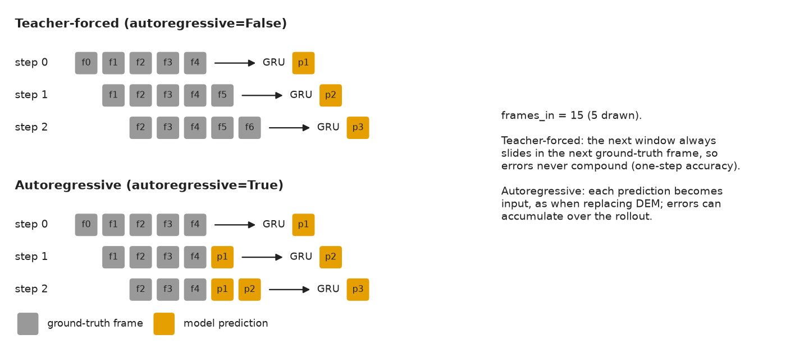

Surrogate model
===============

The surrogate has two halves, each a subpackage split by concern:

- :mod:`pm_dem_sm.model.rnn` -- the GRU that predicts each particle's
  next ``(x, y, z)`` from its last ``frames_in`` steps of ``(x, y, z, r)``:
  ``model``, ``training``, ``loading``.
- :mod:`pm_dem_sm.model.sr` -- the stochastic random (SR) model:
  ``model``, ``fitting``, ``loading``; see :doc:`sr`.

The two steps that use both halves sit at the top of the package:
:mod:`pm_dem_sm.model.training` (``do_train``) and
:mod:`pm_dem_sm.model.prediction` (``do_predict``). TensorFlow is imported
only when a GRU method is called.

Building the network
--------------------

:class:`~pm_dem_sm.model.rnn.model.RNNModel` is the GRU's counterpart to
:class:`~pm_dem_sm.model.sr.model.SRModel`: one object with ``build``,
``predict``, and ``save``/``load``. It wraps the Keras network (it does not
subclass it), so saved files stay plain ``.keras`` models.
``RNNModel.build`` creates
``Input(frames_in, n_features) -> GRU -> Dense(tanh) -> Dense(3)``,
compiled with Adam and MSE:

.. code-block:: python

   from pm_dem_sm.model.rnn import RNNModel

   model = RNNModel.build(frames_in=15, n_features=4, gru_units=20, dense_units=15, learning_rate=0.01)
   model.network.summary()

``model.network`` is the Keras model itself, for anything Keras-specific,
such as fitting on your own ``(X, y)``, e.g. from :doc:`data_processing`:

.. code-block:: python

   model.network.fit(X_train, y_train, validation_data=(X_val, y_val), epochs=5, batch_size=500)
   xyz = model.predict(X_val)  # (N, 3) float32 next positions

Training and saving
-------------------

:func:`~pm_dem_sm.model.training.train_and_save` is the ``do_train``
stage. It loads ``train_data_dir`` once and hands the frames to both halves:

- :func:`~pm_dem_sm.model.rnn.training.train_and_save_rnn` converts the
  trajectories to local mean components (``x - v * dt_step``, paper Eq. 1;
  turn off with ``TrainingOptions(local_mean_conversion=False)``), builds
  the dataset and the network from ``config.training``, fits, and writes
  ``model_path`` plus a ``<name>.history.json`` with the per-epoch
  ``loss`` / ``val_loss``.
- :func:`~pm_dem_sm.model.sr.fitting.fit_and_save_sr` fits the SR model
  on the raw frames and saves it as ``<name>.sr.npz`` (see :doc:`sr`).

.. code-block:: python

   from pathlib import Path
   from pm_dem_sm import ExperimentConfig, TrainingOptions
   from pm_dem_sm.model.training import train_and_save

   cfg = ExperimentConfig(
       model_path=Path("models/rnn_gru_sic_model.keras"),
       training=TrainingOptions(epochs=20, batch_size=500),
   )
   model, history = train_and_save(cfg)
   # models/rnn_gru_sic_model.keras
   # models/rnn_gru_sic_model.history.json
   # models/rnn_gru_sic_model.sr.npz

A ``model_path`` without the ``.keras`` suffix is saved with it added.

Loading a saved model
---------------------

Accepts ``.keras`` and ``.h5`` files, and legacy TensorFlow SavedModel
directories (behind a predict-only adapter, so ``model.network`` has no
``summary``/``fit`` there); either way you get an ``RNNModel``:

.. code-block:: python

   from pm_dem_sm.model.rnn.loading import load_rnn

   model = load_rnn("models/rnn_gru_sic_model.keras")
   print(model.input_shape, model.output_shape)  # (None, 15, 4) (None, 3)

When the exact file is missing, the alternate suffixes and the bare
directory name are tried before raising ``FileNotFoundError``.

Predicting frames
-----------------

:func:`~pm_dem_sm.model.prediction.predict_frames` is the
``do_predict`` stage. It seeds a window with ``frames_in`` ground-truth
frames starting at ``prediction.start_frame``, then predicts one frame per
step. It writes ``pred_frame_XXXXX.parquet`` files under
``prediction.pred_frames_dir`` and a combined
``prediction.pred_combined_parquet``, and returns the combined table:

.. code-block:: python

   from pm_dem_sm import ExperimentConfig, PredictionOptions
   from pm_dem_sm.model.prediction import predict_frames

   cfg = ExperimentConfig(prediction=PredictionOptions(start_frame=66))
   preds = predict_frames(cfg)  # loads cfg.model_path
   preds = predict_frames(cfg, model=model)  # or reuse a model already in memory

Teacher-forced vs. autoregressive
~~~~~~~~~~~~~~~~~~~~~~~~~~~~~~~~~

With ``autoregressive=False`` (default), every step slides the next
**ground-truth** frame into the window, so errors never accumulate: this
measures one-step accuracy. With ``autoregressive=True``, the model's own
``(x, y, z)`` is fed back in, which is how the surrogate would replace DEM:

         only ground-truth frames; autoregressive windows fill up with the
         model's own predictions.
   :width: 100%

   Where each step's newest input frame comes from, in the two modes.

.. code-block:: python

   cfg_ar = cfg.with_overrides(autoregressive=True, predict_until_end=False, max_steps=50)
   preds_ar = predict_frames(cfg_ar, model=model)

``predict_until_end=True`` predicts through the last frame in ``data_dir``;
otherwise ``max_steps`` frames are predicted. With ``stochastic.enabled``,
every step also adds the SR displacement -- the local velocity fluctuation
the GRU's deterministic output leaves out; see :doc:`sr`.
